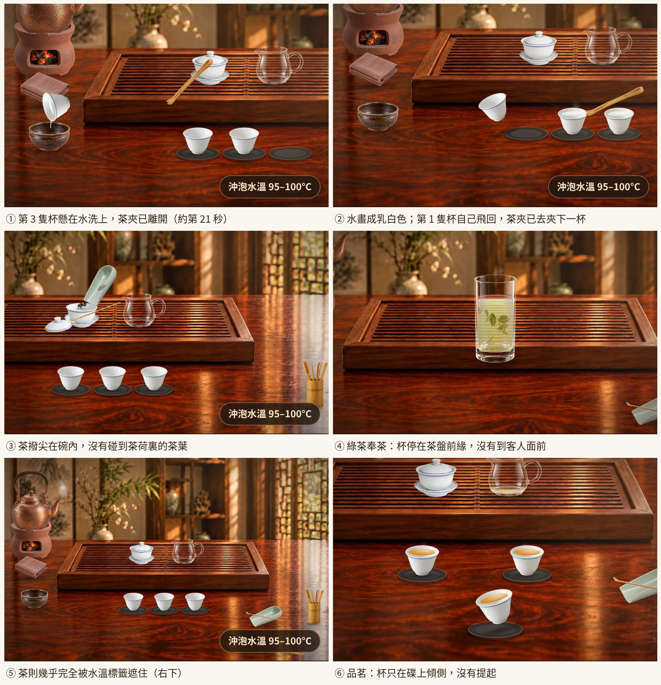
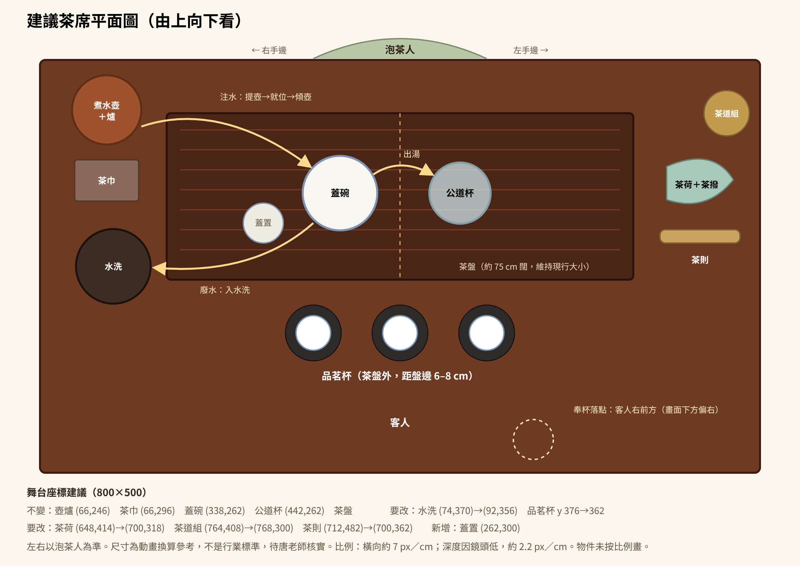
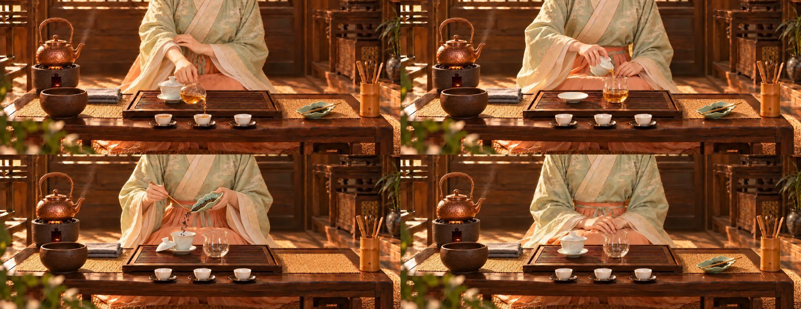

# 茶席動畫真實流程優化建議書

- 日期：2026-10-31（香港時間）
- 項目：茶席・中國茶藝泡茶流程教學，線上版 commit `af4c41d`
- 狀態：第一版；2026-10-31 Oliver 已定案第十節，階段 1、2 已施工（見第十節「定案」）
- 檢查範圍：逐格截圖 21 段動畫（烏龍全部 12 段、熟普 2 段、綠茶 7 段）；讀 `stage.js`、`kit.js`、`data.js`、全部 19 張人物圖；對照你給的 7 張實拍參考圖及公開資料
- 未做到：未請真人茶藝師實演比對，未在手機真機檢查，其餘 5 款茶未逐格截圖；文內厘米數是動畫換算參考，不是行業標準

---

## 一、結論

現行動畫的**茶席位置大致已對**，主要差距在**器具怎樣動**。器具現在像被隱形的線拉着飛，沒有真人的「提起、就位、傾倒、收水、放回」節奏，而且有幾件茶具只作擺設，流程亦缺了收具。

最影響真實感的 8 項：

| # | 問題 | 影響 |
|---|---|---|
| 1 | 每隻杯倒完溫杯水後，杯自己飛回杯碟；第 3 隻在水洗上空時，茶夾已先離開約 0.5 秒 | 違反物理，看得最清楚 |
| 2 | 茶撥不是在茶荷上撥茶，撥尖插在蓋碗內；方向亦與人物圖相反 | 手法錯誤 |
| 3 | 茶巾全程沒有使用，水洗的水位全程不變 | 器具淪為裝飾，這正是你之前指出的問題 |
| 4 | 「續泡收具」沒有收具動作，流程停在第二泡注水 | 欠缺正式流程的終點 |
| 5 | 水畫成乳白色，像牛奶 | 溫杯段一看就假 |
| 6 | 壺、公道杯一邊飛一邊已開始傾斜 | 真人是先到位才傾倒 |
| 7 | 公道杯把手朝泡茶人左邊，人物圖卻是右手斟茶 | 左右兩幅不一致 |
| 8 | 所有蓋碗茶都用同一種高沖及刮沫，綠茶奉茶杯停在茶盤邊 | 不同茶類的手法沒有分別 |

**建議做法：** 先確立「一雙手的規則」，再修第九節 S、A 級共 19 項問題，之後逐步重排動作，最後重生人物圖。全部不需要把手畫回來，也不需要改動你已定案的茶席位置。

---

## 二、依據與已定案事項

### 2.1 參考資料怎樣用

1. **你的指示及參考相片**：最高優先。
2. **職業競賽的規定流程及評分細則**：用來核對步驟次序、湯量及奉茶要求。
3. **公開茶藝文章及百科**：只作輔助。不同流派寫法不同，部分來源可信度一般。

資料本身有分歧，例如壺放左或放右。南山居主張煮水器放左手邊[^1]，若水則說明兩種都有，以順手為準，其店內正是右手注水、壺放右邊[^2]。所以**本建議書以你的做法為準，不判定其他流派錯誤**。涉及手法細節的地方都列在第十節，請唐老師定案。

### 2.2 已定案，不再更改

| 事項 | 現行定案 |
|---|---|
| 步驟次序 | 備具 → 賞茶 → 溫杯 → 投茶 → 聞香 → 潤茶 → 沖泡 → 出湯 → 分茶 → 奉茶 → 品茗 → 續泡收具 |
| 煮水壺 | 泡茶人右手邊 |
| 水洗 | 茶盤右前角（泡茶人視角） |
| 茶巾 | 右手邊近身處 |
| 蓋碗、公道杯 | 平行，以茶盤中線左右均分 |
| 品茗杯 | 在茶盤外，泡茶人與客人之間 |
| 茶盤 | 大茶盤 |
| 蓋碗注水量 | 八成 |
| 溫杯 | 用茶夾夾杯，水倒入水洗 |
| 不擺 | 花瓶、茶罐（動畫內） |
| 手部 | 動畫內不畫手 |
| 聲音 | 取消叮噹聲，用真實水聲，以輕柔為主 |

### 2.3 與競賽規定流程的差異

| 項目 | 競賽規定 | 我們 | 建議 |
|---|---|---|---|
| 結尾 | 綠、紅、烏龍皆以「收具」作結[^3] | 沒有收具動作 | **補上** |
| 紅茶 | 不洗茶[^4] | 不潤茶，一致 | 保留 |
| 溫盅及品茗杯 | 紅茶、烏龍在沖泡後才溫[^3] | 投茶前溫 | 保留，家用及教學都常見；但要在文字說明杯要盡早使用 |
| 綠茶 | 溫杯、置茶、浸潤泡、搖香、沖泡[^3] | 中投＋搖杯＋聞香＋沖泡 | 保留，順序相近 |
| 湯量 | 評分細則為五分至七分滿，分杯均勻[^5] | 文字七分，畫面接近九分 | 改畫面 |

---

## 三、一雙手的規則（全部動作的基礎）

動畫不畫手，但每件器具都要**看起來由某隻手拿着**。每段動作先定誰拿、從哪邊來、放回哪裏。

| 器具 | 建議用手 | 拿法（不畫手，由角度及路線暗示） | 現況 |
|---|---|---|---|
| 煮水壺 | 右手 | 提梁，壺嘴向茶盤 | 正確 |
| 蓋碗 | 右手 | 三指法：拇指、中指扣碗沿，食指按蓋鈕[^6] | 正確 |
| 公道杯 | **右手（待定）** | 握把手 | 把手朝泡茶人左邊，等於左手用；人物圖是右手 |
| 茶荷 | 左手 | 托起，尖端向蓋碗 | 方向對，傾斜過度 |
| 茶撥 | 右手 | 由泡茶人右側伸入茶荷 | **方向相反** |
| 茶夾 | 右手 | 夾杯沿 | 位置對，但茶道組在左手邊，要跨身取用 |
| 茶巾 | 左手或右手 | 蘸壺底、拭水跡 | **從未使用** |
| 奉杯 | 雙手 | 右手持杯、左手托底，不碰杯口[^7] | 動線對，只奉 1 杯 |

**公道杯的取捨：** 建議統一用右手，因為人物圖已是右手。做法是把公道杯圖左右翻轉，令把手朝泡茶人右邊，斟茶時壺嘴朝泡茶人左邊。代價是推翻第四輪「嘴朝左」的定案，並要重調斟茶角度及杯序，所以列入第十節請你確認。

---

## 四、茶席位置與比例

### 4.1 比例換算

鏡頭較低，橫向約 7 px／cm，深度約 2.2 px／cm（由杯碟橢圓約 0.3 的扁度推算，屬估算）。

| 物品 | 現行寬度 | 參考實物 | 判定 |
|---|---|---|---|
| 蓋碗碗身 | 66 px | 約 10 cm | 合理 |
| 公道杯 | 82 px | 約 12 cm（連把手） | 合理 |
| 品茗杯 | 49 px | 約 6 cm | 合理，前排略大屬透視 |
| 水洗 | 68 px | 約 12 cm | 合理，人物圖的水洗明顯較大 |
| 煮水壺 | 125 px | 約 18 cm（連嘴） | 合理 |
| 茶盤 | 523 px | 約 75 cm | 大型茶盤，符合你的要求 |
| 玻璃杯 | 寬 60、高約 130 px | 約 7×13 cm 為常見小杯 | **過高**，約等於 19 cm |
| 茶荷（賞茶時） | 放大約一倍 | 12–14 cm | **放大過度** |

### 4.2 每件物品的位置

| 物品 | 現行座標 | 建議座標 | 原因 |
|---|---|---|---|
| 煮水壺＋爐 | (66,246) | 不變 | 已定案 |
| 茶巾 | (66,296) | 不變 | 已定案，壺回位時剛好經過 |
| 水洗 | (74,370) | **(92,356)** | 貼近茶盤右前角，蓋碗及杯的搬運距離橫向縮短約 18 px；要重驗不與茶巾重疊 |
| 蓋碗 | (338,262) | 不變 | 已定案 |
| 公道杯 | (442,262) | 不變 | 已定案 |
| 品茗杯 | y=376，杯距 76 | **y=362**，杯距不變 | 現時與茶盤相隔約 12 cm，改為 6–8 cm，符合「靠近茶盤」 |
| 茶荷 | (648,414) | **(700,318)** | 人物圖在茶盤旁邊，動畫放得太前 |
| 茶道組 | (764,408) | **(768,300)** | 同上，左手邊與茶荷同一區 |
| 茶則 | (712,482) | **(700,362)** | 現時被水溫標籤遮住 |
| 蓋置 | 沒有 | **新增 (262,300)** | 碗蓋現時直接放在茶盤條柵上；公開資料亦把蓋置列為常見器具[^8] |

### 4.3 人物圖與動畫的差異

| 差異 | 建議 |
|---|---|
| 人物圖茶盤約佔畫面 40%，動畫約 65% | 動畫是特寫，可保留差異 |
| 人物圖桌上有茶席布，動畫沒有 | 重做動畫背景時加入，或從人物圖移除；建議加入，茶席感更強 |
| 人物圖沒有茶則 | 重生人物圖時加入 |
| 人物圖水洗比動畫大得多 | 動畫維持你要求縮小後的 68 px，重生人物圖時把水洗縮小 |
| 投茶時茶荷離碗約 30 cm | 重生，降至 5–8 cm |
| 高沖時壺舉至肩高 | 重生，壺嘴離碗約 12–15 cm，與動畫一致 |

---

## 五、全域動作規則

### 5.1 器具移動五段式

| 階段 | 動作 | 建議時間 |
|---|---|---|
| 起 | 垂直提起 2–3 cm，不可斜線離桌 | 0.25 秒 |
| 移 | 弧線移到目標，全程保持直立 | 按距離 0.4–0.8 秒 |
| 停 | 到位後靜止片刻 | 0.15 秒 |
| 倒 | 開始傾斜，水流由細轉穩 | 按內容 |
| 收 | 回正收水，稍停，再循弧線回位，垂直放下 | 0.8–1 秒 |

現行 `kettlePour()`、`pitcherPour()` 把移動及傾斜放在同一段，要拆開。

### 5.2 水與茶湯

| 項目 | 現況 | 建議 |
|---|---|---|
| 清水顏色 | `WATER #dfeef3` 不透明，像牛奶 | 透明度 0.15–0.25，只留液面反光及邊線 |
| 茶湯 | 透明度固定 | 按 `tint` 由清水過渡至 0.74 |
| 水柱開始 | 已會生長 | 保留 |
| 水柱結束 | 突然停 | 水流變細 → 斷開 → 最後 1–2 滴落回器內 |
| 水洗 | 水位不變 | 加水位層，每次廢水升高，收具時顯示滿度 |
| 液體守恆 | 公道杯分茶後剩 0.06，下一步變 0.12；杯量與公道杯減幅無關 | 用 5.3 的容量表計算 |
| 杯內液面 | 七分滿看似九分 | 液面橢圓縮小，並下移至杯高約 65% |
| 葉底 | 烏龍球形茶由頭到尾同一體積 | 潤茶及每泡後舒展，體積約 1 → 1.6 倍 |

### 5.3 容量表

以下為換算假設，目的是令畫面一致：

| 器具 | 容量假設 |
|---|---|
| 蓋碗 | 畫面維持八成 |
| 公道杯 | 約 220 ml，水位 = 實際水量 ÷ 220 |
| 品茗杯 | 約 40 ml，七分 ≈ 28 ml，3 杯共 84 ml |

例子：烏龍 110 ml，公道杯水位 0.50，分茶後剩 26 ml（0.12）；紅茶 150 ml，水位 0.68，分茶後剩 66 ml（0.30）。餘茶留待續斟，畫面亦合理。

### 5.4 鏡頭

- 每步最多「一個主鏡頭＋收回全景」。
- 溫杯現時約 5 次構圖變化，改為 3 個：全景 → 蓋碗公道杯 → 杯排連水洗。
- 杯排到水洗相隔約 400 px，該鏡頭縮放不可超過 1.25。

### 5.5 陰影與接觸

- 器具離桌時影子要留在桌面，隨高度變淡，品茗杯及玻璃杯已做到，要推廣到壺、蓋碗、公道杯、茶荷、茶夾。
- 放下時有 0.05 秒輕微下沉及低頻悶響。
- 桌面反光強，但器具沒有倒影，建議加淡倒影，否則物件像浮在桌上。

### 5.6 用茶巾

只加 3 處，避免重複：

1. **第一次注水後**：壺回位途中在茶巾上輕按一下，蘸去壺底水氣（字幕只出現一次）。
2. **潤茶倒水後**：蓋碗放回前，碗底在茶巾上方輕觸一下（待唐老師確認）。
3. **收具**：拭乾茶盤及杯碟水跡。

公開資料亦提到茶巾用於擦拭壺底、杯底水滴[^1]，綠茶流程亦有以茶巾托壺底的做法[^9]。

---

## 六、每個步驟的優化

時長以烏龍茶為例，現行 12 段共約 98 秒。

### 第 1 步：備具迎客

| 項目 | 內容 |
|---|---|
| 真實流程 | 淨手、布具、煮水、向客人行禮。布具有次序，不是所有器具一併出現 |
| 現況 | 器具按次序淡入（5.2 秒）；淡入不是擺放；茶則看不見 |
| 器具 | 按「壺爐 → 茶盤 → 蓋碗 → 公道杯 → 杯 → 水洗 → 茶巾 → 茶荷 → 茶道組 → 茶則」出現 |
| 動作 | 改為由近身處輕移 8–12 px 落位＋淡入，每件 0.25 秒，總長約 6 秒 |
| 字幕 | 「淨手・布具・煮水」→「今日水溫」→「請客人入座」 |
| 鏡頭 | 全景不動 |
| 驗收 | 全部器具完整可見，無一被標籤遮擋 |

### 第 2 步：賞茶

| 項目 | 內容 |
|---|---|
| 真實流程 | 乾茶放在茶荷，雙手捧給客人看外形、色澤及香氣 |
| 現況 | 字幕說「以茶則取茶」，但沒有茶罐，茶葉只是淡入；茶荷放大約一倍；茶撥一直壓在茶葉上 |
| 建議 | 因動畫不放茶罐，改為**茶葉已量好放在茶則上，由茶則倒入茶荷**，令茶則有實際用途 |
| 動作 | 茶則移到茶荷上方 → 傾斜 → 茶葉滑入 → 茶則回位 → 茶撥移到茶道組或茶荷側 → 茶荷雙手托起移到客人方向 → 停 2 秒 → 回位 |
| 茶荷 | 放大不超過 1.25 倍，傾斜約 10–15° 向客人展示 |
| 字幕 | 改「茶葉量好，放入茶荷」；`data.js` 的「從茶罐取茶」同步修改 |
| 時長 | 約 7.5 秒 |
| 驗收 | 茶葉由茶則進入茶荷，不是憑空出現 |

### 第 3 步：撬茶（只限普洱）

| 項目 | 內容 |
|---|---|
| 真實流程 | 茶餅放穩，由邊緣或縫隙插入，順着紋理慢慢撬開，手指避開刀路[^10][^11] |
| 現況 | 茶餅直接放在桌面；茶刀由右下插入；用語對，動作幅度小 |
| 器具 | 新增茶餅墊或開茶盤，茶餅不直接放在桌面 |
| 動作 | 插入約 1–2 cm，約 45° 以內，左右輕晃 2 次，再向上挑，茶塊先鬆開再落入茶荷 |
| 位置 | 茶荷新位置要緊貼茶餅，撬下的茶不可跨越長距離 |
| 字幕 | 保留「每次撬少量」 |
| 時長 | 維持約 10 秒 |
| 待定 | 由邊緣開始，抑或由餅背中心茶窩開始，資料有兩種說法[^12]；請唐老師定 |

### 第 4 步：溫杯燙盞

這是現時最長、問題最多的一段（22.2 秒）。

| 項目 | 內容 |
|---|---|
| 真實流程 | 水入蓋碗 → 溫碗 → 入公道杯 → 分到杯 → 夾杯溫杯 → 倒入水洗 |
| 程式錯誤 1 | 倒水後杯回位只有 0.13 秒，第 3 隻約飛 390 px，同時茶夾已去下一隻 |
| 程式錯誤 2 | 茶夾在第 3 隻杯未放下前已開始返回茶道組（`t1` 計算太早） |
| 文字衝突 | 文字寫水量一至兩成，動畫蓋碗注到 0.55，公道杯 0.6 |
| 水量 | 蓋碗 0.25，公道杯及杯相應減少；蓋碗要輕轉一圈溫碗（現時沒有） |
| 夾杯動線 | 取夾 → 夾杯 → 垂直提起 → 就地轉杯 → 弧線移到水洗 → 傾倒 → **由茶夾夾着返回** → 放下 → 鬆夾 |
| 杯序 | 由最近水洗的杯開始（畫面左至右） |
| 每杯時間 | 約 3.6 秒（回程 0.8 秒），由 3.3 秒稍加 |
| 省時 | 溫碗及公道杯部分壓縮約 2 秒，總長控制在 20 秒內 |
| 茶夾造型 | 保留開合；手柄要朝泡茶人方向，不可橫過蓋碗上空（圖 ①） |
| 字幕 | 三隻杯不重複全文，第 2、3 隻只出現「第二杯」「第三杯」 |
| 鏡頭 | 見 5.4 |
| 水洗 | 每杯倒水後水位升一級 |
| 驗收 | 全程杯離碟時茶夾必定接觸杯沿；杯速不超過 5.7 的上限 |

### 第 5 步：投茶

| 項目 | 內容 |
|---|---|
| 真實流程 | 左手托茶荷，尖端向碗口；右手持茶撥，將茶葉由荷內推向尖端入碗 |
| 現況 | 茶荷傾斜近直立；茶撥橫放，撥尖在碗內，由畫面右邊進入（圖 ③） |
| 茶荷角度 | 約 25–35°，尖端離碗口 2–3 cm |
| 茶撥路線 | 由**畫面左方**（泡茶人右側）進入茶荷尾端 → 貼着荷面向尖端推 2–3 次 → 離開 |
| 茶葉 | 每推一次落下一批；荷內茶堆由尾端向尖端減少，不是整堆縮小 |
| 碗蓋 | 開蓋放到蓋置，投完再合蓋 |
| 時長 | 維持約 6 秒 |
| 玻璃杯 | 同一手法，茶葉落在水面後慢慢下沉 |
| 驗收 | 放大截圖：撥尖全程在茶荷上方，不進入碗內 |

### 第 6 步：聞香

| 項目 | 內容 |
|---|---|
| 真實流程 | 溫熱的蓋碗放入乾茶後合蓋輕搖，開蓋一道縫，湊近聞香 |
| 現況 | 碗只升 14 px，全景下幾乎看不見（6 格幾乎相同） |
| 蓋碗動作 | 連碟輕提 → 搖 3 下 → 升高約 60–70 px → 碗蓋開縫 → 鏡頭輕推 |
| 香氣 | 加 2–3 縷極淡氣息，不用文字或圖示 |
| 文字 | 「聞蓋上乾香」改「聞碗內乾茶受熱的香氣」；這時聞的是溫熱乾茶，不要與「熱香」混用 |
| 玻璃杯 | 已改善，保留；杯高縮小後重調 |
| 時長 | 維持約 7 秒 |
| 驗收 | 手機窄屏也看得出碗被提起 |

### 第 7 步：潤茶

| 項目 | 內容 |
|---|---|
| 真實流程 | 水沿碗壁入碗至剛浸過茶葉，合蓋留縫，快速倒去 |
| 現況 | 水位 0.5 偏多；蓋碗搬運距離長（約 265 px），經過茶巾旁 |
| 水量 | 0.3–0.35，剛好浸過茶葉 |
| 注水 | 定點沿碗壁，壺嘴離碗約 3–4 cm |
| 倒水 | 水洗內移後縮短路線；碗保持低位，不要先升很高 |
| 茶巾 | 碗回位前輕觸（待確認） |
| 茶葉 | 潤後開始舒展，體積略增 |
| 適用 | 紅、綠、黃、茉莉不潤；白茶可省（`data.js` 已註明） |
| 時長 | 維持約 7.5 秒 |
| 驗收 | 水洗水位上升；水柱全程落在水洗內 |

### 第 8 步：沖泡

| 項目 | 內容 |
|---|---|
| 真實流程 | 按茶性選擇注水高度、落點及路線，再合蓋計時 |
| 現況 | 6 款蓋碗茶同樣高沖＋刮沫，壺在空中不動，人物圖舉得比動畫高 |
| 注水 | 改用第七節每款茶的參數 |
| 路線 | 需要環圈的茶，壺嘴走小圓 1.5 圈（半徑約 12 px） |
| 方向 | 回旋注水公開資料多寫逆時針[^13]，統一用同一方向 |
| 刮沫 | 只限烏龍，其他茶不做 |
| 收水 | 水柱先細後斷，壺回正稍停，然後回位，途中蘸茶巾 |
| 水量 | 維持八成 |
| 時長 | 烏龍約 8 秒；計時仍標「示範已加快」 |
| 驗收 | 8 款茶注水畫面可見分別 |

### 第 9 步：出湯

| 項目 | 內容 |
|---|---|
| 真實流程 | 三指持碗，蓋留縫，碗口靠近公道杯，傾斜出湯並瀝乾 |
| 現況 | 高度已符合 2–3 cm，留縫及尾滴亦有；是現時最接近真實的一段 |
| 保留 | 距離、蓋縫、碗碟留原位 |
| 改善 | 傾角由 60° 慢慢增至 92°，配合水位下降；瀝乾時輕抖 1–2 下；落水處公道杯液面要有輕微波動 |
| 公道杯 | 若翻轉把手，碗口路線要避開把手 |
| 鏡頭 | 保留單一連續鏡頭 |
| 時長 | 維持約 6.3 秒 |
| 驗收 | 碗內水位、公道杯水位按比例同步變化 |

### 第 10 步：分茶

| 項目 | 內容 |
|---|---|
| 真實流程 | 公道杯低位斟入各杯，水量均勻 |
| 現況 | 公道杯在杯之間夾縫下斟，幾乎與杯同高；水位 0.82→0.06 與實際水量不符；杯看似九分滿 |
| 位置 | 公道杯保持在杯排**後方**（畫面較上），杯底高於杯口，壺嘴斜向杯中 |
| 高度 | 壺嘴離杯口約 2–3 cm，低斟但不可碰杯 |
| 收水 | 每杯結束先回正，再移到下一杯，杯之間不可滴水 |
| 杯序 | 依公道杯用手而定（第十節） |
| 分量 | 三杯液面完全一致；按 5.3 計算 |
| 時長 | 約 7.5 秒 |
| 驗收 | 三杯液面差異不超過 1 px；公道杯任何一幀不與杯重疊穿插 |

### 第 11 步：奉茶

| 項目 | 內容 |
|---|---|
| 真實流程 | 雙手奉杯到客人右前方，請用茶，客人叩指回禮[^7][^13] |
| 現況 | 杯連碟推出，方向正確，距離短；只奉中間一杯，另兩杯留在原位 |
| 蓋碗版 | 建議按次序奉 3 杯，第 1 杯完整示範，第 2、3 杯加快（第十節） |
| 落點 | 推至杯排前方約 15–20 cm，偏客人右手 |
| 玻璃杯版 | **補杯托**；由茶盤移到桌面；現時杯停在茶盤前緣（圖 ④） |
| 叩指禮 | 不畫手，以字幕＋桌面兩下輕微波紋表示；或用人物圖 |
| 字幕 | 保留「請用茶」；加「茶湯燙，先稍放涼」 |
| 時長 | 約 9 秒 |
| 驗收 | 杯及杯托完整落在桌面，不壓茶盤 |

### 第 12 步：品茗

| 項目 | 內容 |
|---|---|
| 真實流程 | 客人拿起杯，看湯色、聞香、分三口品 |
| 現況 | 杯在碟上原地傾側，像快要倒下（圖 ⑥）；液面亦隨杯傾斜幅度不足 |
| 動作 | 一看：杯略提起並鏡頭推近；二聞：升高約 70 px 並有香氣；三品：再升高接近畫面上方，傾斜，水位逐次下降，回碟 |
| 液面 | 杯傾斜時液面保持水平 |
| 杯底香 | 飲後杯再提起一次，配字幕 |
| 另外兩杯 | 若奉 3 杯則留在客人位置 |
| 時長 | 維持約 9 秒 |
| 驗收 | 杯離碟有明顯高度，碟留原位 |

### 第 13 步：續泡收具（建議拆成兩步）

現時只有第二泡注水，而且上一步杯內的茶、奉出的杯突然消失。

**13A 續泡（`again`）**

| 項目 | 內容 |
|---|---|
| 動作 | 開蓋 → 注水 → 合蓋 → 計時 → 出湯 → 續斟（可加快） |
| 連戲 | 杯保持品茗後狀態，已奉出的杯收回或原位續斟 |
| 顯示 | 時間列出第 2 泡、中段、末三泡的變化 |
| 葉底 | 每泡體積再大一點，湯色逐漸變淡 |

**13B 收具（新增 `clear`）**

| 次序 | 動作 | 位置 |
|---|---|---|
| 1 | 茶湯味淡，宣告結束，向客人致意 | 全景 |
| 2 | 收回杯，殘水倒入水洗 | 杯排 → 水洗 |
| 3 | 開蓋，葉底撥到茶荷給客人看（可選） | 蓋碗 → 茶荷 |
| 4 | 葉底倒入水洗，熱水燙洗蓋碗及公道杯 | 蓋碗、公道杯 → 水洗 |
| 5 | 用茶巾拭乾杯碟及茶盤 | 茶巾移到器具處再回位 |
| 6 | 器具循布具的相反次序歸位，茶夾、茶撥回茶道組 | 全部回原位 |
| 7 | 水洗水位滿度顯示，結束行禮 | 全景 |

時長約 14 秒，並要新增人物圖及文字。

---

## 七、八款茶的注水建議

參數表現有的水溫、茶量及泡數不變，只新增注水方式。下表屬建議，**未有足夠權威資料，須請唐老師定案**。

| 茶 | 器具 | 水溫 | 潤茶 | 注水高度 | 落點 | 路線 | 刮沫 |
|---|---|---|---|---|---|---|---|
| 綠茶 | 玻璃杯 | 80–85°C | 不潤 | 鳳凰三點頭 | 沿杯壁 | 三起三落 | 無 |
| 白茶 | 蓋碗 | 90–95°C | 可省 | 低至中（5–8 cm） | 沿碗壁 | 定點，不直沖芽葉 | 無 |
| 黃茶 | 玻璃杯 | 85–90°C | 不潤 | 中低 | 沿杯壁 | 定點 | 無 |
| 烏龍 | 蓋碗 | 95–100°C | 5 秒 | 高（12–15 cm） | 沿碗壁 | 環圈 | 有 |
| 紅茶 | 蓋碗 | 90–95°C | 不潤 | 低至中 | 沿碗壁 | 定點 | 無 |
| 生普 | 蓋碗 | 95–100°C | 5 秒 | 中 | 沿碗壁 | 定點或環圈 | 無 |
| 熟普 | 蓋碗 | 100°C | 10 秒 | 中高 | 沿碗壁 | 環圈 | 無 |
| 茉莉花茶 | 蓋碗 | 85–90°C | 不潤 | 中 | 沿碗壁 | 定點 | 無 |

程式上在 `data.js` 每款茶加 `pour: {h, spot, path, foam}`，由 `stage.js` 讀取，不要在動畫內逐款寫死。

**玻璃杯流程另加：**

- 杯高由約 130 px 減至約 92 px，配杯托。
- 溫杯傾 105° 太誇張，改為約 75° 倒水。
- 葉片舒展改用多張 `wet-*` 素材過渡；奉茶及品茗的流程與蓋碗同一標準。

---

## 八、每件器具的優化

| 器具 | 圖像 | 動作 | 位置 |
|---|---|---|---|
| 煮水壺 | 保留 | 五段式；傾壺在到位後；出水後收水；蘸巾 | 不變 |
| 炭爐 | 保留 | 壺離爐時爐口露出，火光略亮 | 不變 |
| 蓋碗（碗、碟、蓋） | 保留，加蓋置 | 蓋：提起→外移→落到蓋置，內面朝上或側靠，待定 | 不變 |
| 公道杯 | 可能翻轉；杯壁保持幼薄 | 五段式；只在到位後傾斜；液面波動 | 不變 |
| 品茗杯＋杯托 | 保留；液面重畫 | 溫杯連茶夾；奉杯連托 | y=362 |
| 玻璃杯 | 縮短；加杯托 | 見第七節 | 不變 |
| 茶盤 | 保留 | 水不落茶盤；濺水痕收具時抹走 | 不變 |
| 水洗 | 維持 68 px，加內部水位層 | 水位累積 | (92,356) |
| 茶巾 | 需一張摺起、使用中的狀態圖 | 3 處使用 | 不變 |
| 茶荷 | 保留 | 放大不超過 1.25 倍；傾角 25–35° | (700,318) |
| 茶撥 | 保留 | 由泡茶人右側進入，貼茶荷推 | 用完回茶道組 |
| 茶則 | 保留 | 賞茶時倒茶入茶荷 | (700,362) |
| 茶夾 | 保留開合 | 手柄方向重調；全程夾穩才移動 | 用完回茶道組 |
| 茶道組 | 保留 | 取用時工具真正從筒內抽出 | (768,300) |
| 茶餅、茶刀 | 加墊 | 茶刀小幅搖動後才挑起 | 茶荷旁 |
| 蓋置 | **新增** | 開蓋時接蓋 | (262,300) |
| 茶席布 | **新增（背景）** | 不動 | 茶盤下方延伸至杯排 |
| 茶巾狀態圖、葉底碗中圖 | **新增** | 收具用 | 收具用 |

---

## 九、全部問題清單

**S 級：看得見的錯誤（先修）**

| # | 問題 | 位置 |
|---|---|---|
| 1 | 杯 0.13 秒飛回杯碟 | `stage.js` warm，`u+2.86→u+2.99` |
| 2 | 第 3 隻杯未放下，茶夾已回茶道組 | `stage.js` warm，`t1` |
| 3 | 茶撥不在茶荷上，方向相反 | `stage.js` 茶撥繪製段、add |
| 4 | 水畫成乳白色 | `WATER`、`tint()` |
| 5 | 分茶結束 0.06，奉茶開始 0.12 | share、`preset.serve` |
| 6 | 綠茶奉杯停在茶盤邊 | serve 玻璃杯版 |
| 7 | 茶則被水溫標籤遮住 | `HOME.scoop` |
| 8 | 品茗杯只原地傾側 | taste |
| 9 | 續泡時奉出的杯及杯內茶突然消失 | `preset.again` |

**A 級：不符真實流程**

| # | 問題 |
|---|---|
| 10 | 壺及公道杯移動途中已傾斜 |
| 11 | 茶巾從未使用 |
| 12 | 水洗水位不變 |
| 13 | 收具動作不存在 |
| 14 | 溫杯水量與文字不符 |
| 15 | 蓋碗茶注水手法一式一樣；刮沫套用在所有蓋碗茶 |
| 16 | 字幕「以茶則取茶」與畫面不符 |
| 17 | 聞香動作看不見 |
| 18 | 碗蓋直接放在條柵上 |
| 19 | 公道杯用手與人物圖不一致 |

**B 級：真實感及質感**

| # | 問題 |
|---|---|
| 20 | 杯七分滿看似九分 |
| 21 | 液體未守恆 |
| 22 | 玻璃杯過高，茶荷放大過度 |
| 23 | 葉底不舒展（蓋碗茶） |
| 24 | 溫杯段鏡頭變化過多 |
| 25 | 大部分器具離桌時沒有留在桌面的影子，桌面沒有倒影 |
| 26 | 「蓋上乾香」「乾香、熱香」用語不準 |

**人物圖：**

| # | 問題 | 處理 |
|---|---|---|
| 27 | 溫杯 22 秒只用注水圖，與夾杯不符 | 新增夾杯圖 |
| 28 | 收具沿用迎客圖 | 新增收具圖 |
| 29 | 高沖舉得過高、投茶茶荷過高 | 重生 2 張 |
| 30 | 沒有茶則、茶盤及水洗比例與動畫有別 | 由母圖一併更新 |

---

## 十、需要你及唐老師確認

**定案（2026-10-31，Oliver）：** 公道杯用右手；其餘按下表預設；蓋碗茶注水一律**定點落在碗邊、控制水柱、注至八成滿**，取代第七節的環圈及落點欄（注水高度保留按茶調整，刮沫只限烏龍；綠茶鳳凰三點頭不變）。

已施工：階段 1、2，另連帶做了公道杯翻轉、蓋置、茶則倒茶、奉 3 杯、聞香提碗、品茗提杯。未做：水洗水位累積、茶巾使用、收具 13B、玻璃杯縮短、布具次序、茶席布、人物圖重生；溫杯現長約 23 秒，高於第六節 20 秒的目標。

每項已附預設做法。如無異議，就按預設開工。

| # | 事項 | 選項 | 預設 |
|---|---|---|---|
| 1 | 公道杯用哪隻手 | A 右手，翻轉圖片；B 左手，人物圖要改 | **A** |
| 2 | 分茶杯序 | 由泡茶人右至左；或左至右 | 跟第 1 項，A 時由畫面左至右 |
| 3 | 奉幾杯 | 奉 3 杯；或只示範 1 杯 | **3 杯，後兩杯加快** |
| 4 | 蓋置 | 新增；或蓋靠碗碟邊 | **新增** |
| 5 | 茶則用途 | 由茶則倒茶入茶荷；或撤走茶則 | **倒茶入茶荷** |
| 6 | 收具葉底 | 先給客人看葉底；或直接倒掉 | **直接倒掉，保持節奏** |
| 7 | 第七節注水表 | 由唐老師逐款修訂 | 按表 |
| 8 | 撬茶起點 | 邊緣；或茶窩 | 邊緣 |
| 9 | 手部 | 維持不畫 | **維持** |

---

## 十一、施工次序

| 階段 | 內容 | 規模 | 成果 |
|---|---|---|---|
| 1 | S 級 9 項＋座標調整 | 小 | 明顯錯誤全部消失 |
| 2 | 五段式引擎、水與茶湯、容量表、影子 | 中 | 全部動作變穩；要全面回歸測試 |
| 3 | 第 2–12 步逐步重排，按茶類注水 | 大 | 手法到位 |
| 4 | 續泡、收具、茶巾、水洗 | 中 | 流程完整 |
| 5 | 新增素材、重生人物圖 | 中 | 兩邊一致；生圖按規則用 Codex |
| 6 | 請唐老師看全片，按意見修 | 小至中 | 內容定稿 |

建議每階段上線一次，由你看過再做下一階段，避免一次改動太多。

---

## 十二、驗收標準

**程式自動檢查（新增 `e2e_realism.py`）**

1. 器具單幀移動不超過 18 px（60 fps 下約 1,080 px／秒），只有鏡頭切換除外。
2. 杯離碟的每一幀，茶夾必定接觸杯沿。
3. 傾斜角大於 8° 時，器具必須已靜止於目標位置。
4. 水柱落點全程在目標器具開口內。
5. 液體守恆，全程誤差不超過 2%。
6. 三杯液面差不超過 1 px。
7. 每件器具在每步結束時位置與 `HOME` 相同，或有明確狀態交接。
8. 相鄰兩步的銜接狀態一致，不跳變。
9. 全部器具不被 HUD 標籤遮擋。
10. 8 款茶 × 全部步驟 × 兩種風格，無 console 錯誤。

**人手檢查**

- 每步抽 6 幀，放大檢查器具接觸、液面及陰影。
- 動畫與人物圖並排核對方位。
- 手機 390 px 及電腦 1440 px 各看全片。
- 把全片交唐老師，按第六節逐步簽核。

**交付等級：** 階段 1–5 完成只算預覽版。要唐老師看過、內容無誤，才算商用版。

---

## 參考資料

[^1]: 南山居，〈告別雜亂無章！一張圖看懂中式茶席的黃金佈局與道具擺放邏輯〉：https://nsteaset.com/%E5%91%8A%E5%88%A5%E9%9B%9C%E4%BA%82%E7%84%A1%E7%AB%A0%EF%BC%81%E4%B8%80%E5%BC%B5%E5%9C%96%E7%9C%8B%E6%87%82%E4%B8%AD%E5%BC%8F%E8%8C%B6%E5%B8%AD%E7%9A%84%E9%BB%83%E9%87%91%E4%BD%88%E5%B1%80%E8%88%87
[^2]: 若水茶知識，茶席擺放方式（Facebook 貼文），https://www.facebook.com/ruoshuicg/posts/-%E8%8C%B6%E7%9F%A5%E8%AD%98%E8%8C%B6%E5%B8%AD%E7%9A%84%E6%93%BA%E6%94%BE%E6%96%B9%E5%BC%8F-%E8%8C%B6%E5%B8%AD%E4%B8%8A%E9%9C%80%E8%A6%81%E7%9A%84%E7%89%A9%E5%93%81%E6%93%BA%E6%94%BE%E6%96%B9%E5%BC%8F%E6%9C%80%E9%87%8D%E8%A6%81%E7%9A%84%E4%B8%80%E9%BB%9E%E6%98%AF%E9%A0%86%E6%89%8B%E8%80%8C%E7%89%A9%E5%93%81%E9%81%B8%E6%93%87%E7%9A%84%E5%84%AA%E5%85%88%E6%A2%9D%E4%BB%B6%E6%98%AF%E5%A5%BD%E7%94%A8%E6%B3%A1%E8%8C%B6%E7%9A%84%E6%B5%81%E6%B4%BE%E5%BE%88%E5%A4%9A%E6%9C%89%E7%9A%84%E7%87%92%E6%B0%B4%E5%A3%BA%E6%94%BE%E5%B7%A6%E9%82%8A%E4%BB%A5%E5%B7%A6%E6%89%8B%E6%B3%A8%E6%B0%B4%E6%9C%89%E7%9A%84%E7%87%92%E6%B0%B4%E5%A3%BA%E6%94%BE%E5%8F%B3%E9%82%8A%E4%BB%A5%E5%8F%B3%E6%89%8B%E6%B3%A8%E6%B0%B4-/1522386959891913
[^3]: 茶藝賽項規定流程：https://www.lku.edu.cn/__local/3/B2/B3/4338B14318A13FD8903D9EDAB97_ACAB5F68_FAA3C.pdf
[^4]: 紅茶規定茶藝註明不洗茶：https://srsj.cngy.gov.cn/Files/UploadFile/SiteFile/20160720104022026/2025/04/17/2a860c7865394533b352fe83785a5f26.pdf
[^5]: 茶藝競賽評分細則，湯量五分至七分滿、分杯均勻：https://he.nvq.net.cn/siteApp/upload/1072/upload/2024-10-28/714/37141730100520015.pdf
[^6]: 菲菲吳小姐，蓋碗「三點一線」持法：https://ffwlife.tw/post-121113692
[^7]: 香港文匯報，〈居家待客的泡茶禮儀〉：http://paper.wenweipo.com/2020/06/10/zt2006100004.htm
[^8]: 韓奕，〈中式茶藝器具介紹〉：https://www.hanyitea.tw/single-post/chineseteaware
[^9]: 綠茶浸潤泡法：https://www.jianshu.com/p/4cdec6e794b1
[^10]: 雲南網，普洱茶撬茶方法：https://m.yunnan.cn/system/2018/11/20/030122135.shtml
[^11]: 嵐雲茶業，撬茶安全要點：https://lanyun.tw/blogs/puertea/how-to-pry-puer-tea-cake
[^12]: 百度百科「開茶」：https://baike.baidu.com/item/%E5%BC%80%E8%8C%B6/12588976
[^13]: 百度百科「奉茶之道」：https://baike.baidu.com/item/%E5%A5%89%E8%8C%B6%E4%B9%8B%E9%81%93/3511418
